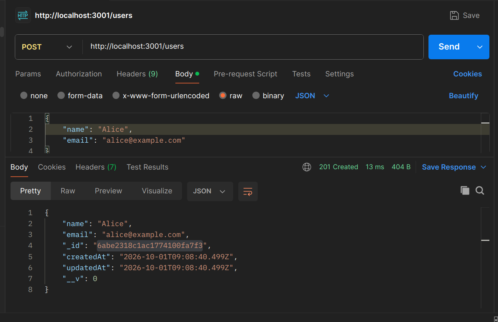
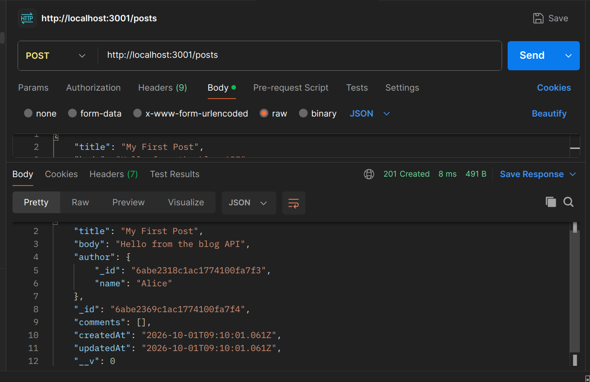
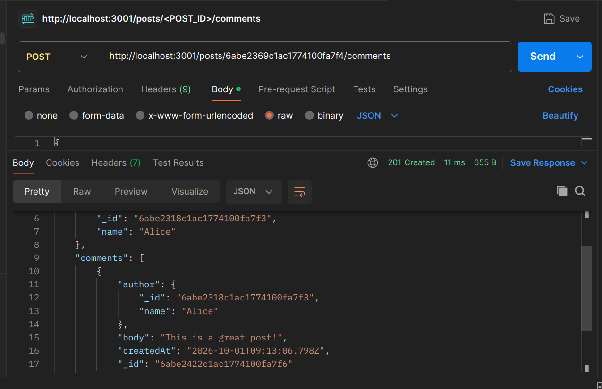

# Mini Blog API

A very small MongoDB + Express API for posts and embedded comments.

## Project setup

1. Open the app folder:
   ```bash
   cd blog-api
   ```
2. Install dependencies:
   ```bash
   npm install
   ```
3. If MongoDB is not running already, start it with:
   ```bash
   mongod --config /etc/mongod.conf
   ```
   > In this environment, MongoDB is already listening on port 27017, so a second instance is unnecessary.
4. Start the API:
   ```bash
   npm start
   ```
   The app uses port 3001 because port 3000 is occupied in this environment.

## MongoDB schema idea

- `users` collection: stores user profile data
- `posts` collection: stores each post with a reference to the author and an embedded comment array

## Endpoints

### Create a user

```bash
curl -X POST http://localhost:3001/users \
  -H "Content-Type: application/json" \
  -d '{"name":"Alice","email":"alice@example.com"}'
```

### Create a post

```bash
curl -X POST http://localhost:3001/posts \
  -H "Content-Type: application/json" \
  -d '{"title":"My First Post","body":"Hello from the blog API","author":"<USER_ID>"}'
```

### List posts

```bash
curl http://localhost:3001/posts
```

This endpoint returns posts with the author populated to just the `name` field.

### Get one post

```bash
curl http://localhost:3001/posts/<POST_ID>
```

This returns the full post with the author populated and each comment's author populated.

### Add a comment

```bash
curl -X POST http://localhost:3001/posts/<POST_ID>/comments \
  -H "Content-Type: application/json" \
  -d '{"author":"<USER_ID>","body":"This is a great post!"}'
```

## Login
  
 ## Add a post 
 ## Add a comment 

## Why embed comments?

Comments are usually fetched together with the post they belong to, especially on blog pages. Embedding them simplifies reads because you can load a post and its comments in a single document query instead of doing an extra `comments` lookup.

This is a good fit for a blog where most users read a post and its comments together, and the number of comments per post is moderate.

## Risk of embedding comments

The biggest risk is document growth. If a post collects hundreds or thousands of comments, the post document becomes large and expensive to update or read. It can also make comment-only queries harder, such as:

- "Show me all comments from a specific user across all posts"
- "List the latest 100 comments regardless of post"
- "Moderate or paginate comments separately"

Large embedded arrays can also increase write contention and storage duplication.

## When to switch to referenced comments

You should move comments to a separate collection when:

- a single post can have a very large number of comments
- comments need independent pagination, filtering, or moderation
- you need to query comments across the whole site
- comment volume grows enough that document size becomes a bottleneck

A practical rule is: if comments start reaching hundreds or thousands per post, or if you need comment analytics and moderation at scale, switch to a `comments` collection with a `postId` reference.

## How to check whether all endpoints are working

Use these checks after starting the server:

```bash
curl http://localhost:3001/health
```

Expected: `{ "status": "ok" }`
