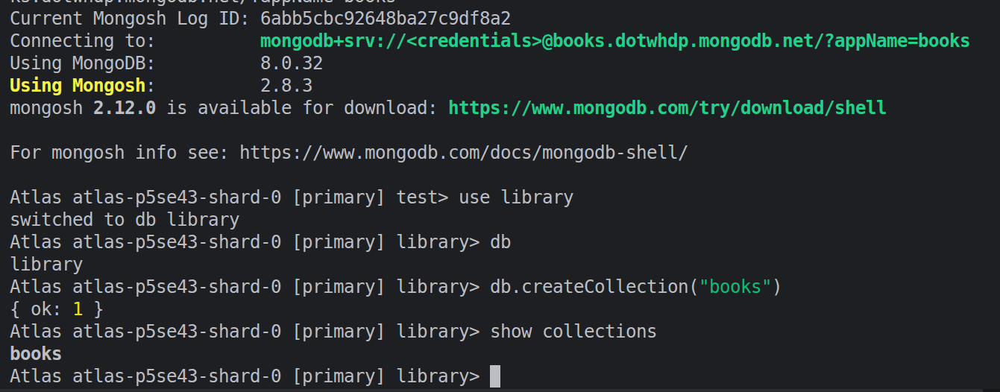
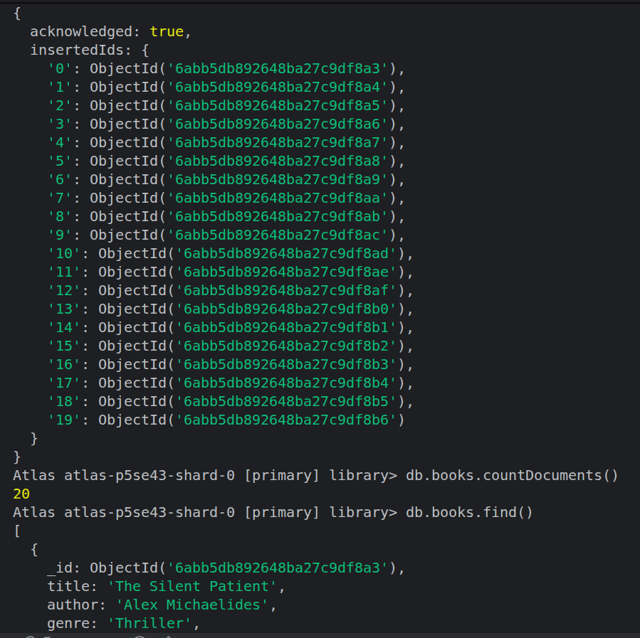
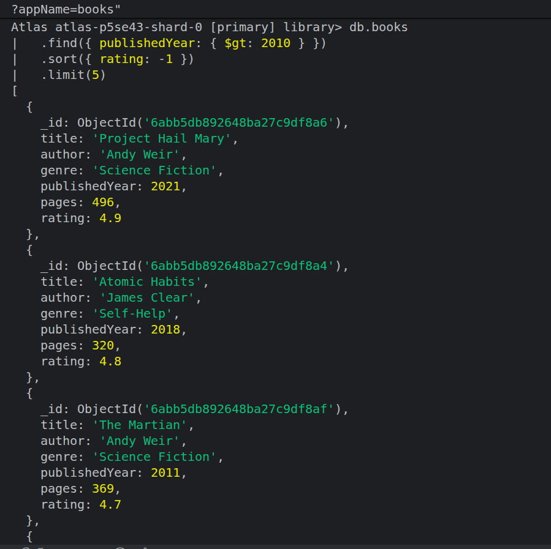
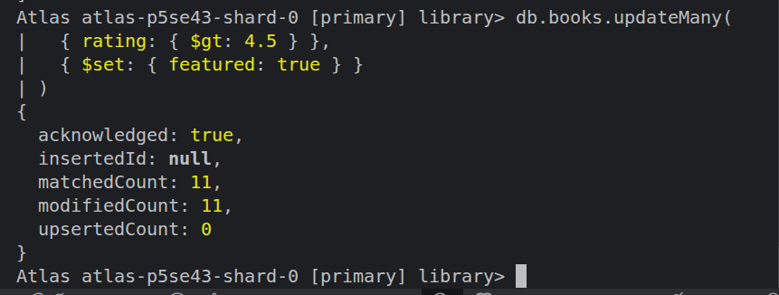
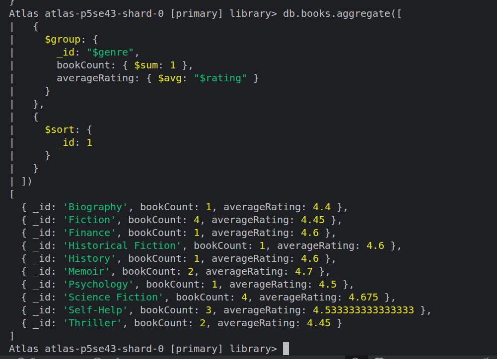
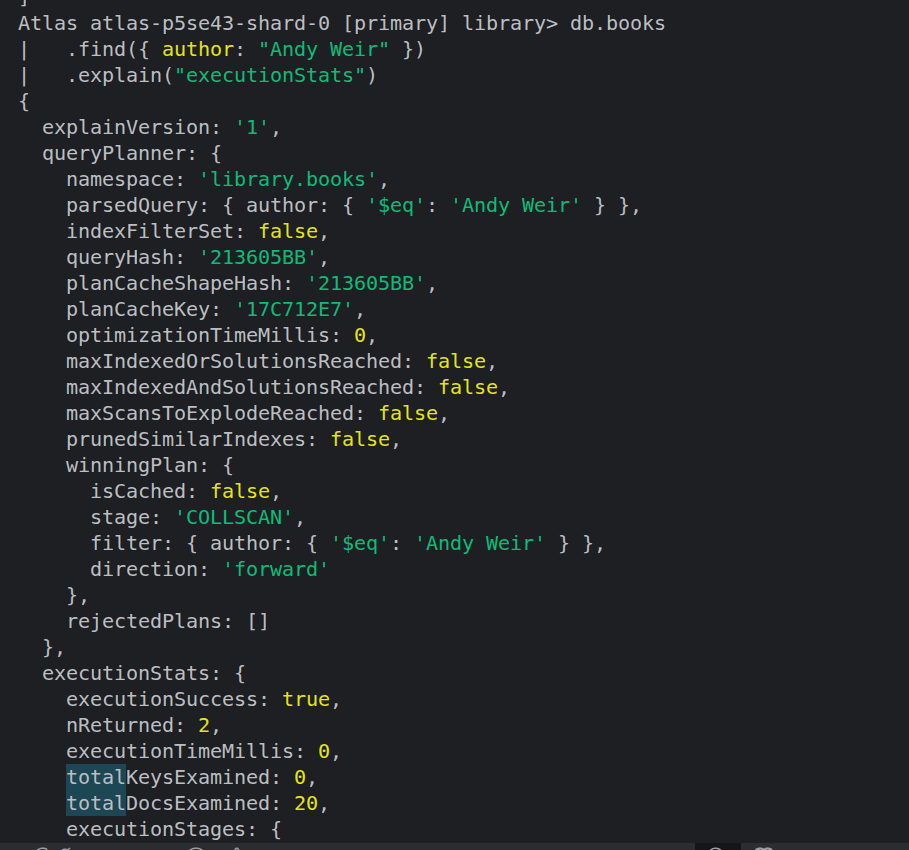
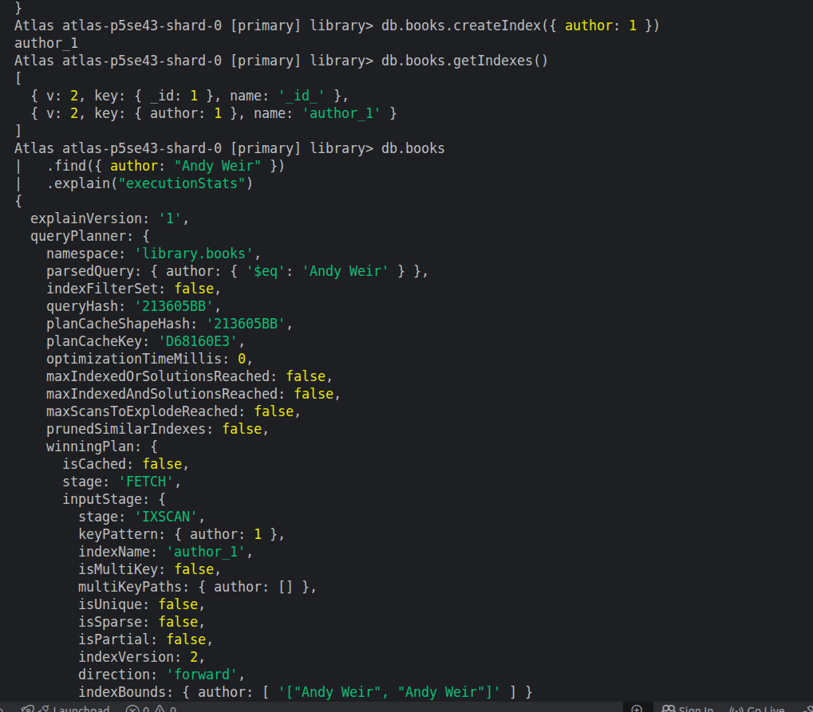
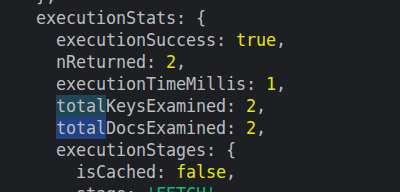

# MongoDB 

## 1. Create Database and Collection

### Commands
```javascript
use library
db.createCollection("books")
show collections
```

### Output
```text
switched to db library
{ ok: 1 }
books
```
 

---

## 2. Insert 20 Books

### Command
```javascript
db.books.insertMany([
  { title: "The Silent Patient", author: "Alex Michaelides", genre: "Thriller", publishedYear: 2019, pages: 336, rating: 4.5 },
  { title: "Atomic Habits", author: "James Clear", genre: "Self-Help", publishedYear: 2018, pages: 320, rating: 4.8 },
  .
  .
  .
])
```

### Output
```text
acknowledged: true
insertedIds: 0 ... 19
```

### Verification
```javascript
db.books.countDocuments()
```

```text
20
```

 

---

## 3. Find Top 5 Books Published After 2010

### Command
```javascript
db.books
  .find({ publishedYear: { $gt: 2010 } })
  .sort({ rating: -1 })
  .limit(5)
```

### Output
```text
Project Hail Mary       2021    4.9
Atomic Habits           2018    4.8
The Martian             2011    4.7
```

*The terminal output continues with the remaining documents; the query successfully applies the required filter, descending rating sort, and limit of 5.*

 
---

## 4. Mark Highly Rated Books as Featured

### Command
```javascript
db.books.updateMany(
  { rating: { $gt: 4.5 } },
  { $set: { featured: true } }
)
```

### Output
```text
acknowledged: true
matchedCount: 11
modifiedCount: 11
upsertedCount: 0
```
 
---

## 5. Aggregate Books by Genre

### Command
```javascript
db.books.aggregate([
  {
    $group: {
      _id: "$genre",
      bookCount: { $sum: 1 },
      averageRating: { $avg: "$rating" }
    }
  },
  {
    $sort: { _id: 1 }
  }
])
```

### Output
```text
Biography          1    4.4
Fiction            4    4.45
Finance            1    4.6
Historical Fiction 1    4.6
History            1    4.6
Memoir             2    4.7
Psychology         1    4.5
Science Fiction    4    4.675
Self-Help          3    4.533333333333333
Thriller           2    4.45
```
 

---

## 6. Compare Query Performance With an Index

### Before Index

#### Command
```javascript
db.books
  .find({ author: "Andy Weir" })
  .explain("executionStats")
```

#### Important Output
```text
winningPlan.stage: COLLSCAN
nReturned: 2
totalKeysExamined: 0
totalDocsExamined: 20
```

`COLLSCAN` means MongoDB scanned the collection to find matching documents.

---

### Create Index

#### Command
```javascript
db.books.createIndex({ author: 1 })
```

#### Output
```text
author_1
```

#### Verify
```javascript
db.books.getIndexes()
```

```text
{ key: { _id: 1 }, name: "_id_" }
{ key: { author: 1 }, name: "author_1" }
```

---

### After Index

#### Command
```javascript
db.books
  .find({ author: "Andy Weir" })
  .explain("executionStats")
```

#### Important Output
```text
winningPlan:
  stage: FETCH
  inputStage:
    stage: IXSCAN
    indexName: author_1

nReturned: 2
totalKeysExamined: 2
totalDocsExamined: 2
```

`IXSCAN` shows that MongoDB is using the `author_1` index.

  


---


## 7. Performance Comparison

| Metric | Before Index | After Index |
|---|---:|---:|
| Execution plan | COLLSCAN | IXSCAN + FETCH |
| Documents examined | 20 | 2 |
| Keys examined | 0 | 2 |
| Documents returned | 2 | 2 |







### Conclusion

The `author` index changed the query plan from `COLLSCAN` to `IXSCAN`.  
For this small collection, the execution time difference is very small, but the index reduces the number of documents examined from 20 to 2.
